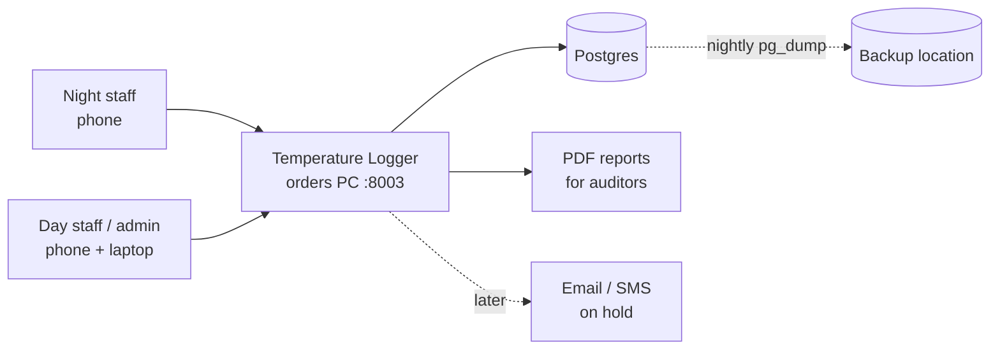
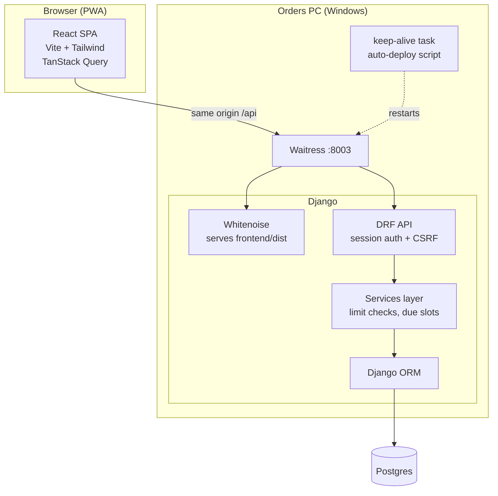
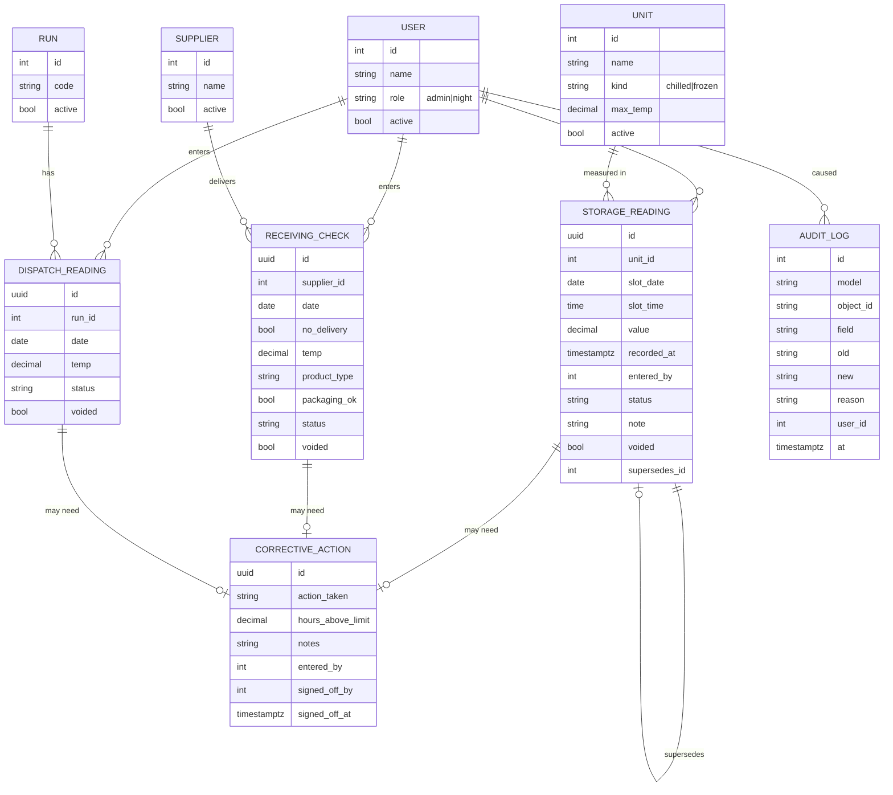
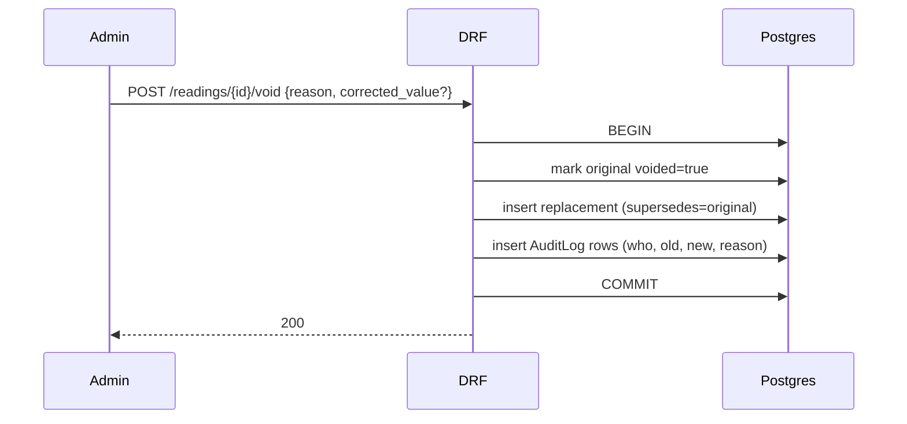
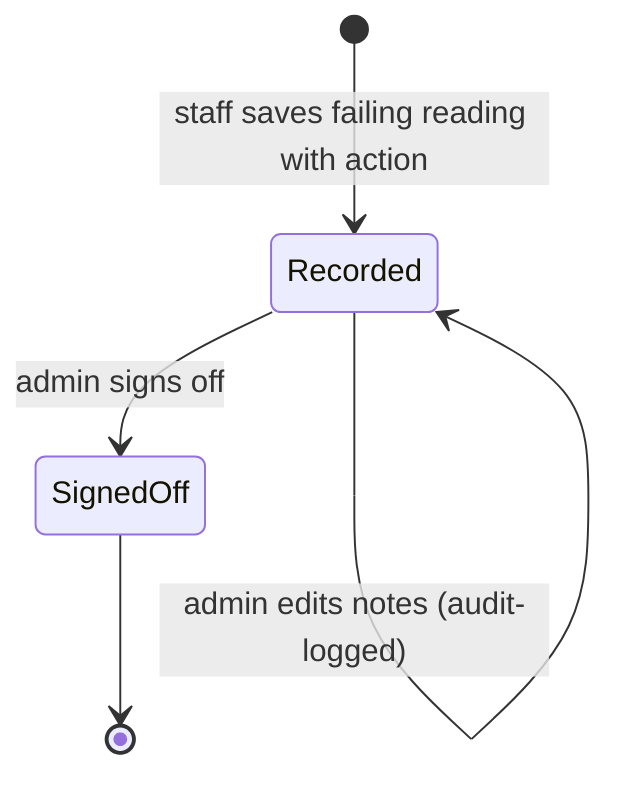
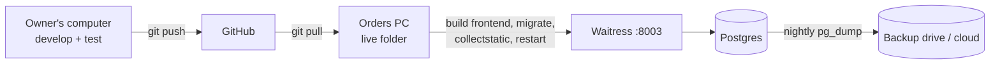

# System Design — Achieve Temperature Logger

Companion to [PLAN.md](../PLAN.md) (what and why) and [CLAUDE.md](../CLAUDE.md) (rules). This file is how it is built. Diagrams use Mermaid (renders on GitHub and in the VS Code Markdown preview).

## 1. Context



Users reach the app on the office LAN, or from home over Tailscale. No public internet exposure.

## 2. Architecture



Key choices:
- **Single origin.** Django serves the built React app and the API together, so session cookies and CSRF just work, with no CORS.
- **Business rules live on the server** (limits, corrective-action requirement, void rules). The UI only mirrors them for fast feedback.
- **Services layer** between views and models holds the rules so they are testable without HTTP.

## 3. Repository layout

```
temp-logger/
  CLAUDE.md  PLAN.md  NOTES.md  README.md
  docs/                 SYSTEM_DESIGN.md
  backend/
    manage.py
    config/             settings, urls, wsgi
    accounts/           User (role), login/logout/me
    setup/              Unit, Supplier, Run, SlotSchedule (admin-managed config)
    readings/           StorageReading, ReceivingCheck, DispatchReading, services.py (limits, due slots)
    corrective/         CorrectiveAction, sign-off
    audit/              AuditLog, void/supersede logic
    reports/            PDF generation, CSV export
    requirements.txt
  frontend/
    src/
      api/              fetch wrapper, query hooks
      components/       Button, NumberPad, StatusBadge, ReadingCard, DataTable, Modal
      pages/night/      Today, Storage, Receiving, Dispatch, Mine
      pages/admin/      Dashboard, Records, Trends, Actions, Reports, Settings
      theme/            Tailwind tokens
  scripts/              run_server.bat, keep_alive.ps1, auto_deploy.ps1, backup.ps1 (modelled on npd-tracker-v2)
```

## 4. Data model



Design details:
- **Corrective action link:** three separate nullable foreign keys (one per reading type) with a database CHECK that exactly one is set. This is preferred over a generic foreign key so integrity is enforced by Postgres. (PLAN.md mentions a generic FK; this supersedes it.)
- **Who took it:** every reading has `entered_by` (the shared login) and `recorded_by` (a required StaffMember chosen from an admin-managed list). Implemented as the abstract model `setup.models.Attributed`.
- **Idempotency:** each submit carries a client-generated UUID that becomes the row id, so a double-tap or retry cannot create a duplicate.
- **Uniqueness:** one non-voided StorageReading per (unit, slot_date, slot_time); one non-voided ReceivingCheck per (supplier, date) unless admin permits extras; one non-voided DispatchReading per (run, date).
- **Limits are copied** onto the reading (`limit_at_time`) so later limit changes never rewrite history.
- **Never delete:** no DELETE endpoints, Django admin delete disabled, and a Postgres trigger raising an error on DELETE for record tables. Deactivate (`active=false`) for users, units, suppliers and runs.
- **Voiding:** sets `voided=true` plus reason, creates a replacement row via `supersedes_id` when a corrected value is given, and writes AuditLog rows, all in one transaction.

## 5. Core logic

### 5.1 Status calculation (server)
```
status = "out_of_limit"  if value > max_temp
         "near_limit"    if value > max_temp - 1.0      (chilled)  /  value > max_temp - 1.0 (frozen: closer to -15)
         "ok"            otherwise
```
Plausibility warnings (not blockers, need "confirm"): positive value for a frozen unit, a jump of more than 10 °C from the previous reading, a value outside -40 to +40.

### 5.2 Due and overdue slots (computed, not stored)
The weekly slot times live in code (`readings/schedule.py`), not in the database. Expected slots for a date range are generated on the fly and compared with existing readings:
- **Upcoming:** slot time in the future.
- **Due:** slot time reached, within the grace window (default 2 h, admin-editable).
- **Overdue / missed:** grace window passed and no non-voided reading exists.

Only the last state counts toward the dashboard "Missed" number.

### 5.3 Saving a reading
```mermaid
sequenceDiagram
    participant U as Staff (phone)
    participant FE as React
    participant API as DRF
    participant SVC as readings.services
    participant DB as Postgres
    U->>FE: types value on NumberPad
    FE->>FE: live status (mirrors limit)
    U->>FE: Save
    FE->>API: POST /api/storage-readings {id, unit, value, [corrective]}
    API->>SVC: validate + compute status
    alt out of limit and no corrective action
        SVC-->>API: 422 corrective_required
        API-->>FE: error
        FE->>U: open corrective-action sheet
        U->>FE: choose action, Save
        FE->>API: POST again with corrective
    end
    SVC->>DB: BEGIN; insert reading; insert corrective; COMMIT
    API-->>FE: 201 + reading
    FE->>U: confirmation, back to Today
```

### 5.4 Void / correct (admin)


### 5.5 Corrective action lifecycle

Unsigned actions show in the dashboard "Waiting for sign-off" count.

## 6. API surface

**Built so far** (all under `/api/`, JSON, session login). "Anyone" means any signed-in login.

| Method and path | Who | Purpose |
|---|---|---|
| POST `auth/login/`, `auth/logout/`; GET `auth/me/`, `auth/csrf/`; POST `auth/change-password/` | Anyone | Sign in with email and password |
| GET `health/` | Public | Is the server up |
| GET `staff/`, `units/`, `suppliers/`, `runs/` | Anyone | Active items for the entry forms. Admin can add `?all=1` |
| POST, PATCH the same four lists | Admin | Add, edit, deactivate (no delete) |
| GET, POST, PATCH `users/` | Admin | Manage logins, reset passwords (no delete) |
| POST `storage-readings/`, `receiving-checks/`, `dispatch-readings/` | Anyone | Log a reading. Sending the same `id` again returns the saved entry |
| GET the same three, plus `{id}/` | Anyone | Night: own entries from the last 2 days. Admin: everything, filter by `from`, `to`, `status`, `include_voided`, `unit` or `supplier` or `run` |
| GET `corrective-actions/` (`?unsigned=1`) | Any login | Corrective actions with a one-line summary of each reading. Admin sees all; the night login sees only those waiting |
| POST `corrective-actions/{id}/signoff/` | Any login | Sign off; body `{"staff": id, "note": "..."}`. `staff` must be an active manager (`can_sign_off`); `note` is required when that person also took the reading. Written to the audit log |
| GET `dashboard/` | Admin | Counts, today progress (`today`), missed storage readings (today and yesterday, after a 2-hour grace period), out-of-limit readings from the last 7 days |
| GET `day/?date=` | Anyone | What is due and already logged on a day: storage slots (done, due, missed, upcoming) per unit, receiving per supplier, dispatch per run |
| POST `{storage-readings,receiving-checks,dispatch-readings}/{id}/void/` | Admin | Void an entry with a reason, optionally with a `replacement` (the correction). Undone entirely if the correction is refused. Written to the audit log |
| GET `audit-log/` | Admin | The audit log (voids, limit changes, login changes) |
| GET `trends/?unit=&from=&to=` | Admin | One unit's temperatures over time |
| GET `reports/{storage,receiving,dispatch}.pdf?from=&to=` | Admin | PDF copying paper Tables 9, 10 and 11 (up to 186 days (about 6 months); whole Sunday-to-Friday weeks; Table 9 has 4 weeks per page with rotated unit names, Tables 10 and 11 have a row per day, starting with a Sunday night row) |
| GET `reading-options/` | Anyone | Limits, corrective-action choices per kind of check, product types, storage slot times |

How saving a reading answers:
- `201` saved (or `200` if the same `id` was already saved).
- `400` the entry is wrong (duplicate, not a scheduled time, deactivated item, missing name, impossible value).
- `422` with `code: needs_confirmation` and `warnings`: the value looks odd, resend with `confirm_unusual: true`.
- `422` with `code: corrective_required`: resend with `corrective: {action, notes, hours_above_limit}`.

**Everything in the plan is built.** Possible later additions: email and SMS alerts, thermometer calibration records (Table 14), the monthly review checklist (Table 15), a non-conformance report (Table 5).

## 7. Security

- Session auth with CSRF protection; passwords hashed by Django; admin sets initial passwords, users change them.
- Role checks on every endpoint via DRF permission classes (not just hidden buttons).
- LAN and Tailscale only; no router port forwarding. Allowed hosts restricted.
- Secrets in `.env` (gitignored); host details in a local gitignored `DEPLOYMENT_NOTES.md` on the orders PC.
- Login throttling, session timeout (long on staff phones, shorter on admin).
- Audit log is append-only; the database trigger also blocks UPDATE/DELETE on it.

## 8. Deployment and operations



- Own Postgres database and user, separate from the other apps. Own port 8003.
- Deploy steps follow npd-tracker-v2: build to a temp folder and swap into `dist`, run migrations, collectstatic, then let the keep-alive task restart Waitress. Never overwrite the live `dist` with a plain build.
- **Migrations are forward-only** and must never drop or rewrite record data.
- Backups: nightly `pg_dump`, keep daily for 30 days and monthly forever, restore tested before go-live. Because nothing is deleted, backup storage is monitored.
- Health check endpoint for the keep-alive task. Logs rotate on disk.

## 9. Non-functional requirements

| Area | Target |
|---|---|
| Speed | Save a reading in under 1 s on the LAN; list pages under 500 ms for a year of data |
| Scale | About 11 storage slots × 4 units a week, about 5 suppliers and 11 runs a day. Tiny, so no caching or queues needed |
| Availability | Office hours plus night shift; if the PC restarts, the keep-alive task brings it back within minutes. Paper fallback sheet remains available |
| Data safety | Never delete, audit trail, nightly backups |
| Usability | Works at 360 px wide, large targets, status by colour + icon + text, WCAG AA contrast |
| Time | Australia/Sydney display, UTC storage, correct across daylight saving |

## 10. Testing

- **Backend (pytest or Django tests):** limit and status rules, plausibility checks, corrective-action requirement, due/overdue slot generation (including Sunday-night and daylight-saving edges), void/supersede transaction, role permissions, DELETE blocked at the database.
- **Frontend:** component tests for NumberPad (± and decimal entry) and StatusBadge; a smoke test of each flow.
- **Manual:** on a real phone in the real coolroom before go-live; run paper and app in parallel for one week and compare.

## 11. Risks and mitigations

| Risk | Mitigation |
|---|---|
| Orders PC down or off at a reading time | Keep-alive restart; paper fallback; late entries allowed with their real `recorded_at` |
| Wi-Fi weak in coolroom | Drafts auto-saved on the device; submit when back in signal. Full offline sync is not in scope now |
| Wrong value typed | Live status, plausibility confirm, admin void with audit trail |
| Shared phones / people forgetting to log out | Named accounts, quick login screen, session timeout |
| Data loss on the single PC | Nightly off-machine backup and a tested restore |
| Mixing up this app with the other apps on the same PC | Own port, own database, own folder, own scheduled task names |

## 12. Open items

- Highlighter colour meaning on Tables 10/11 (owner will confirm later).
- SMS/email alerts are on hold.
