# Achieve HACCP: Temperature Logger User Manual

For the staff of Achieve Cafe Provisions. **Achieve HACCP** is the company's HACCP app. The **Temperature Logger** is the part of it described here, and it replaces the paper temperature sheets (HACCP Plan v1.6, Tables 9, 10 and 11). The screenshots use sample temperatures, not real records.

**Contents**

1. [What it is for](#1-what-it-is-for)
2. [Signing in](#2-signing-in)
3. [Finding your way around](#3-finding-your-way-around)
4. [Storage temperatures (coolrooms and freezers)](#4-storage-temperatures-coolrooms-and-freezers)
5. [When a temperature is too warm](#5-when-a-temperature-is-too-warm)
6. [Receiving deliveries](#6-receiving-deliveries)
7. [Dispatch](#7-dispatch)
8. [Public holidays](#8-public-holidays)
9. [For day staff: checking, correcting and reporting](#9-for-day-staff-checking-correcting-and-reporting)
10. [For day staff: Settings](#10-for-day-staff-settings)
11. [Reminder emails](#11-reminder-emails)
12. [If something looks wrong](#12-if-something-looks-wrong)
13. [Quick reference](#13-quick-reference)

---

## 1. What it is for

The app records three kinds of temperature checks, one screen for each:

| Screen | What you record | Replaces |
|---|---|---|
| **Storage** | The coolrooms and freezers, at set times each day | Table 9 |
| **Receiving** | The temperature of each delivery when it arrives | Table 10 |
| **Dispatch** | The temperature of the load before delivery runs go out | Table 11 |

Every entry is saved with **who took it, and when**. This is what an auditor wants to see, so please always pick your own name (see [Signing in](#2-signing-in)).

**Two rules to know from day one**

- **Nothing is ever deleted.** If you make a mistake, tell day staff. They *void* the entry and enter the right one, and the change is written to a permanent audit log.
- **A reading that is too warm cannot be saved without saying what you did about it.** This is on purpose. It is how the record shows that action was taken.

---

## 2. Signing in

There are two shared logins on the office computer and on any other computer that has the app:

| Login | Used by | Can do |
|---|---|---|
| **Night** | Night staff | Log storage, receiving and dispatch |
| **Admin (day)** | Day staff | Everything the night login can, plus Records, Trends, Reports, Audit log and Settings |

Open the app in your browser, type the email and password you were given, and click **Sign in**. Click the **eye** at the end of the password box to see what you typed, and click it again to hide it.

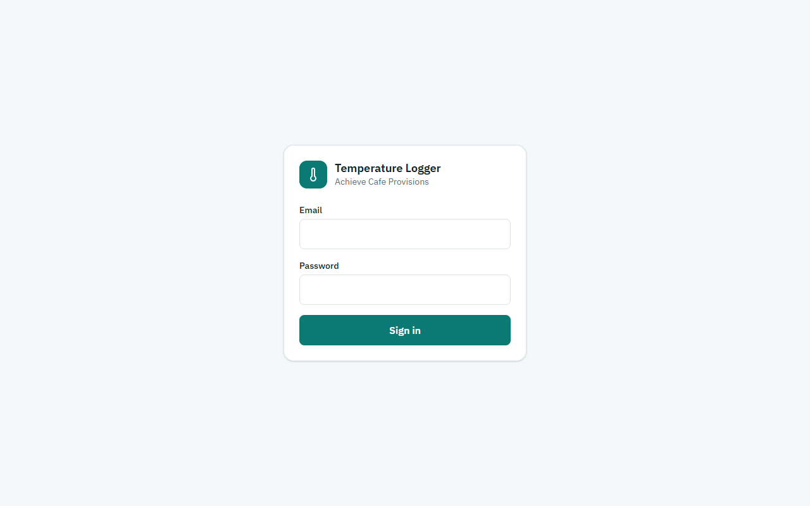

### "Your name"

Because the login is shared, the app also asks **who you are** before you save anything. Pick your name from **Your name** at the top of each logging screen, or from **Who is using this?** at the bottom of the left-hand menu (they are the same choice). The night staff names are listed first, and the day staff at the bottom. The app remembers your name on that computer, so you only have to pick it again if someone else uses the computer.

If your name is not in the list, ask day staff to add it (see [Staff names](#staff-names)).

### Signing out

Click **Sign out** at the bottom of the left-hand menu when you finish, especially on a shared computer.

---

## 3. Finding your way around

### The front page (day login only)

After signing in, **day staff** see the Achieve HACCP front page, with a card for each part of the app. There are three cards: **Temperature Logger**, **Cleaning & Maintenance** (the cleaning tasks of Table 8 and the 6-monthly thermometer calibration of Table 14) and **Records** (every saved record in one place). Click one to open it. The **All modules** link at the top of the left-hand menu brings you back to this page.

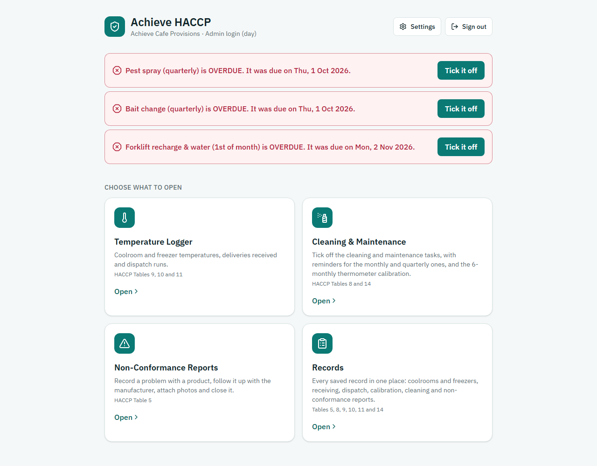

**Night staff** go straight into the Temperature Logger and never see this page. Calibration, Cleaning & Maintenance and Records are for day staff only.

### Records (day staff)

The **Records** card opens one page with a tab for each kind of record: **Coolrooms & freezers**, **Receiving**, **Dispatch**, **Calibration** and **Cleaning**. Each tab has the same filters (month, day, unit, supplier or run, out of limit only, show voided) and the same **Void / correct** button. The Temperature Logger and Calibration menus also have their own **Records** page that shows only their own records, for quick access.

### Cleaning & Maintenance (day staff)

This is the paper Table 8. **Tick tasks** (the home page) shows every task for one day: pick your name and the day, tick what was done, add a note if you want one, and press **Save**. A task that is already ticked for that day is locked and shows who did it and when.
- **Tasks done more than once a day**, like **Stock put away** after each delivery, never lock. Each time you tick it and press Save is saved as another entry (with your name, the time and an optional note, for example which delivery), and the row lists every time. The Records page shows them as "time 2", "time 3", and the PDF shows a tick with "x2", "x3". Any task can be set to work this way on the **Tasks** page.

- **Every working day** tasks (bathroom check, warehouse cleans, van cleans and so on) are due Monday to Friday.
- **Monthly** and **quarterly** tasks (forklift recharge, pest spray, bait change) say "Due" until they have been ticked in that month or quarter, then show the date they were done.
- A **note** can have several lines: press **Enter** in it to start a new line, and **Ctrl+Enter** (or Tab) to move on to the next task. The reason you give when voiding works the same way (Ctrl+Enter voids). Records, the Audit log and the PDF keep the line breaks.
- If a tick was made by mistake, open **Records**, press **Void** and give a reason. The task can then be ticked again. Nothing is ever deleted.
- **Records** also has the **Table 8 PDF** for the dates you choose, laid out like the paper table with a "Done by" column.
- **Tasks** is where you add a new van, rename a task, change how often it is due, or deactivate one that is no longer done.
- **Notifications** lists the monthly and quarterly tasks that are due (forklift recharge, pest spray, bait change), the thermometer calibration, and the reminder emails already sent. A task is due from the first working day of its month or quarter until it is ticked off, and is marked overdue after a week. A reminder email goes out when it falls due and again every week while it is not done (emails only start once the task has been ticked in the app at least once). A red number beside Notifications in the menu shows how many are due. On the **Tasks** page, the **Send reminders** tick chooses which tasks do this.
- Cleaning has its **own Audit log**.

### Calibration (day staff, inside Cleaning & Maintenance)

In the Cleaning & Maintenance menu, under **Table 14: Calibration**. The home page shows when the next 6-monthly thermometer calibration is due (a notice appears 15 days before). **New calibration** opens the Table 14 form: the probe in iced water must read 0 °C give or take 1 °C, and you can also compare each coolroom or freezer gauge with the probe. A reading outside the margin needs an action (replaced or repaired); a note is optional. On Save a PDF copy is made and copied to Drive. **Records** lists every calibration with its PDF and a **Void** button (a reason is required). Calibration has its **own Audit log**; its voids do not appear in the Temperature Logger's.

### Inside the Temperature Logger

The menu is down the left side. **Home** is the first thing you see once you are in.

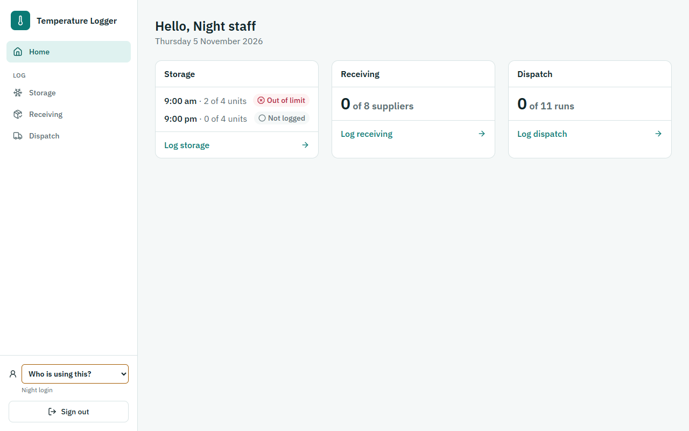

On the night login, Home shows **today's checklist**: each storage time with how many units are logged so far, and how many suppliers and runs have been logged. Click **Log storage**, **Log receiving** or **Log dispatch** to go straight to that screen.

Day staff see the **Dashboard** instead (see [section 9](#9-for-day-staff-checking-correcting-and-reporting)).

**Using the keyboard.** The app is made for desktop computers and laptops. You can type a temperature, press **Enter** to save it, and use **Tab** to move to the next box. On every screen **Enter** also moves you on to the next box, so you can work without the mouse (the Quick reference at the end lists what Enter does on each screen).

---

## 4. Storage temperatures (coolrooms and freezers)

### When are they due?

| Day | Times |
|---|---|
| Sunday | 9:00 pm |
| Monday to Thursday | 9:00 am and 9:00 pm |
| Friday | 9:00 am and 3:00 pm |

(On the day before a public holiday the 9 pm reading is taken at 3 pm instead. See [Public holidays](#8-public-holidays).)

The units are the **Coolroom**, **Old Coolroom**, **Freezer** and **Chest Freezer**. Coolrooms must be **5 °C or colder**. Freezers must be **-15 °C or colder**.

### How to log them

1. Click **Storage** in the menu.
2. Pick **Your name**.
3. Check the **time tab** at the top (for example *9:00 am*). The app picks the one most likely to be next. Click another tab if you need to.
4. Click the temperature box for a unit, type the number, and press **Enter**. The row shows **Logged by** with your name, and the cursor moves on to the next unit.

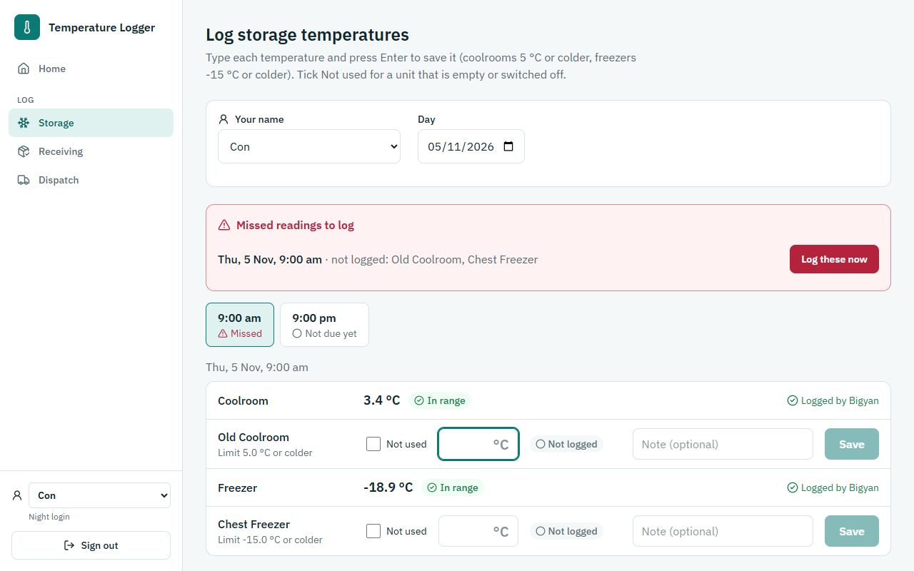

You can also type all the temperatures first, then click **Save all** at the bottom to save them together.

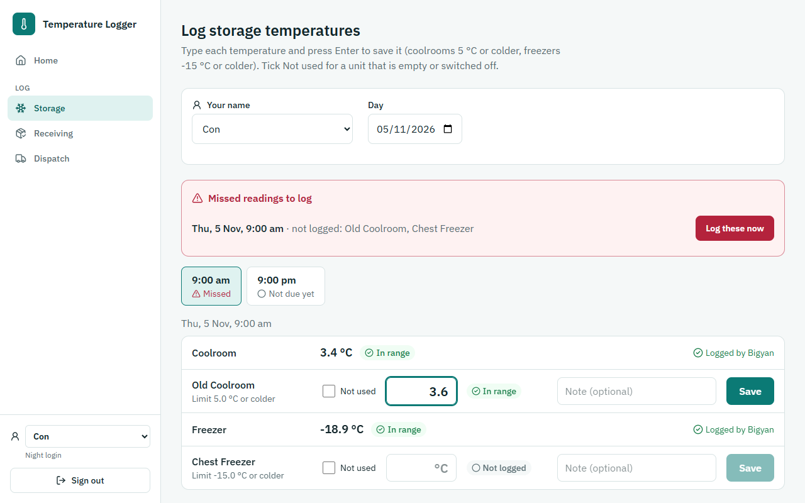

As you type, the label beside the box tells you how it looks **before** you save:

| Label | Meaning |
|---|---|
| **In range** | Within the limit |
| **Near limit** | Within 1 °C of the limit. Still allowed, but keep an eye on it |
| **Out of limit** | Too warm. You will be asked what you did about it (see [section 5](#5-when-a-temperature-is-too-warm)) |

**Negative numbers.** For a freezer, type the minus sign, for example `-18.5`. If you type a freezer reading above 0 °C, the app asks you to check it, because a missing minus sign is the usual cause.

**Unit empty or switched off?** Tick **Not used** for that unit instead of typing a temperature.

### The time tabs

Each time tab has a status so you can see what needs doing:

| Status | Meaning |
|---|---|
| **Done** | Every unit is logged |
| **Not due yet** | Still to come |
| **Due now** | Due within the last 2 hours |
| **Missed** | More than 2 hours late and not all logged |
| **Public holiday** | Nothing needs logging at this time |

### Logging a late or missed reading

If a reading was missed, a red **Missed readings to log** box appears at the top of the screen. Click **Log these now**. The app opens the right day and time for you. Log it as soon as you can and add a note if you can explain why it was late.

---

## 5. When a temperature is too warm

If you type a temperature over the limit, the row shows **Out of limit** and a pink box opens below it: **"This is out of limit. What was done about it?"**

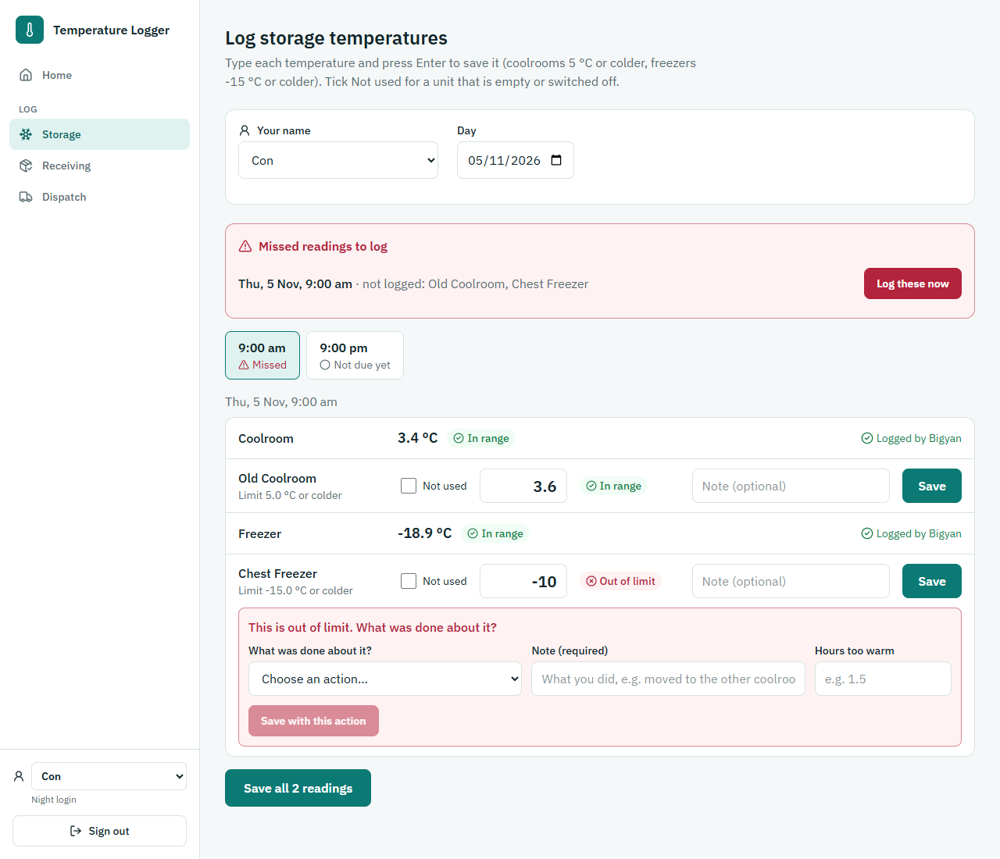

You must fill in:

1. **What was done about it.** Choose from the list.
2. **Note (optional).** If it helps, one short sentence about what you actually did, for example "Moved stock to the Coolroom and checked the door."
3. **Hours too warm** (storage only). How long the food was above the limit, if you know.

Then click **Save with this action**.

The choices depend on the screen:

| Screen | Choices |
|---|---|
| Storage | Used immediately · Moved to another unit · Discarded · Repair or replacement arranged |
| Receiving | Delivery rejected · Accepted: supplier showed the food is safe · Moved to the coolroom immediately · Supplier notified |
| Dispatch | Operations Manager contacted · Temperature re-checked · Discarded |

The corrective action then shows on the printed reports under the main table, with your name as **Logged by**.

> If a reading looks wrong (for example `-8` for a coolroom, or a big jump from the last reading), the app shows **Please check this value**. If you typed it correctly, click **Yes, that is correct**. If not, fix the number.

---

## 6. Receiving deliveries

Use this each time a delivery arrives.

1. Click **Receiving**.
2. Pick **Your name** and check the **Day**.
3. Find the supplier in the list. Choose the **product type** (**Chilled**, **Frozen** or **Freshly baked pies**). Some suppliers start on Frozen because they usually deliver frozen.
4. Type the temperature. Do this for each supplier that delivered.
5. If the packaging was damaged or unclean, **untick Packaging OK**. You will be asked for a corrective action, the same as for a temperature that is too warm.
6. If nothing came from a supplier today, you can tick **No delivery** for them, or simply leave that row empty.
7. Type a temperature and press **Enter** to jump to the next supplier's temperature box (Enter in a Note box does the same), so many deliveries can be typed without touching the mouse. Pressing **Enter** on the last supplier, or clicking **Save** at the bottom, saves every row you filled in together.

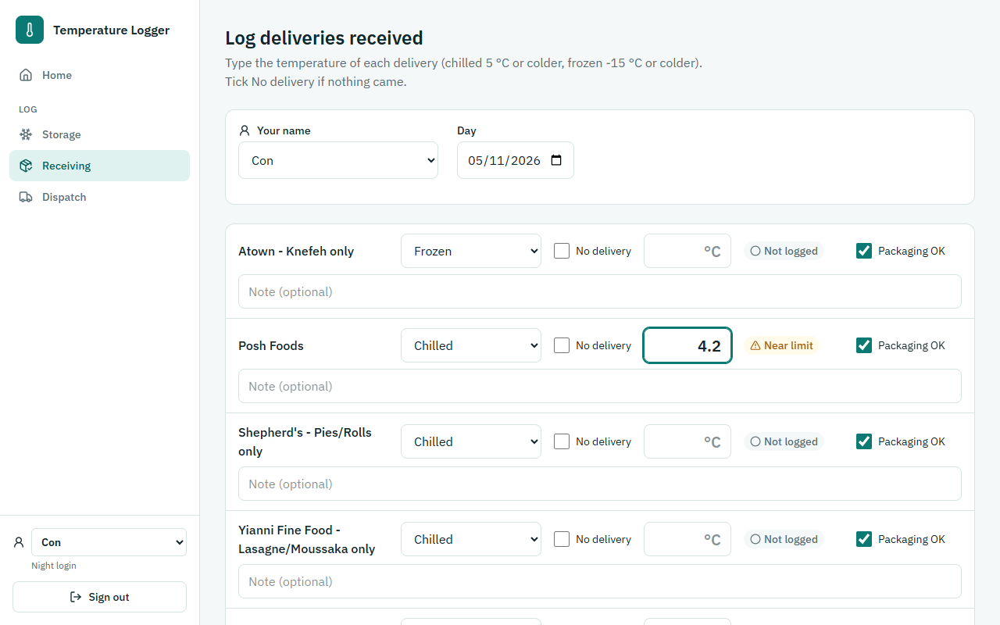

Limits:

| Product | Must be |
|---|---|
| Chilled | 5 °C or colder |
| Frozen | -15 °C or colder |
| Freshly baked pies | Over 5 °C is acceptable **only if moved to the coolroom immediately** (choose that corrective action) |

A supplier can only be logged once per day. If you get it wrong, ask day staff to void and correct it (see [section 9](#void-and-correct-an-entry)).

---

## 7. Dispatch

Dispatch is logged **once for the load**, then you tap the runs that went out.

1. Click **Dispatch**.
2. Pick **Your name**.
3. Type the **Load temperature** (must be 5 °C or colder).
4. Tap each run that went out, **or press its letter** on the keyboard. The runs are A, B, C, D, E, G, H, J, K, L and M (there is no F or I).
5. Click **Save**. One reading is saved for every run you tapped.

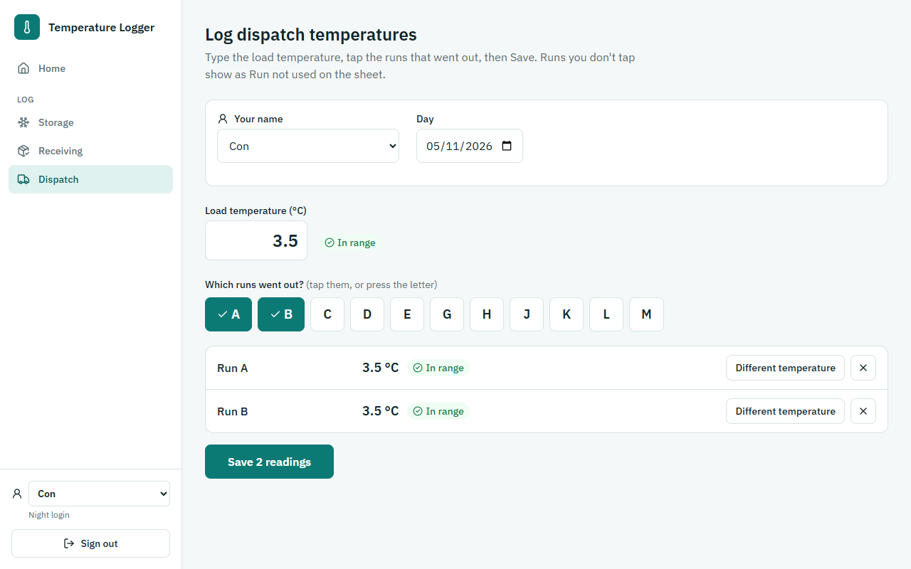

- A run that had a **different temperature** can be changed with **Different temperature**.
- Tapped the wrong run? Click the **×** next to it.
- **Runs you did not tap are not recorded.** On the printed sheet they show **Run not used** by themselves, so you do not need to enter anything for a run that did not go.

Dispatch normally goes out in the morning. The sheet counts a run as "not used" from 7 am.

---

## 8. Public holidays

On a public holiday some readings are not needed. Day staff add the holiday in advance (see [Public holidays in Settings](#public-holidays-1)), and the app then does the following for you.

| When | What is due |
|---|---|
| **The holiday itself** | Daytime storage readings are **not** needed. Receiving and Dispatch are **not** needed. |
| **The holiday's evening (9 pm)** | **Still needed**, because deliveries go out the next morning (if the next day is a working day). |
| **The day before, Monday to Thursday** | The 9 pm reading is **replaced by a 3 pm reading**, because nobody is in at night. |
| **Sunday before a Monday holiday** | **Not** needed. Sunday is off. |
| **Two holidays in a row** | Only the last holiday keeps its 9 pm reading. |

For example, if **Friday** is a public holiday: Thursday has **9 am and 3 pm** (no 9 pm), and Friday is skipped entirely.

What you will see:

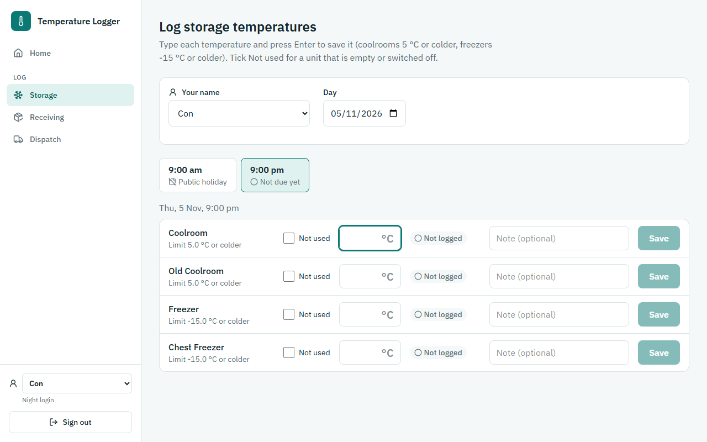

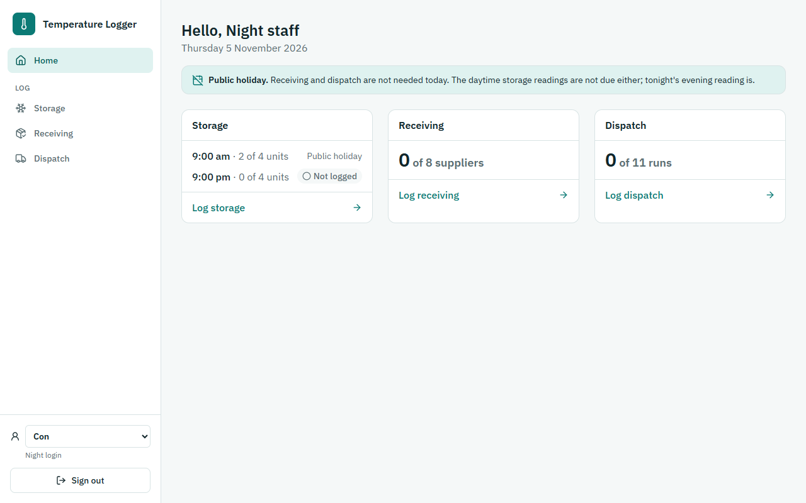

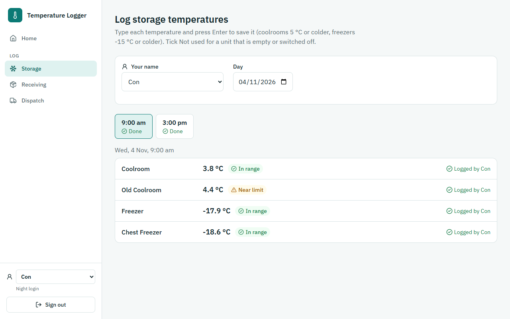

On a holiday:

- **No reminder emails** are sent for readings that are not needed, and they are never shown as **Missed**.
- The printed reports say **Public holiday** instead of leaving a blank.
- You can **still log a reading** if you took one. It is kept as normal.

---

## 9. For day staff: checking, correcting and reporting

These pages are on the **Admin (day)** login only.

### Dashboard

The Dashboard is the first page on the day login. It tells you what needs attention.

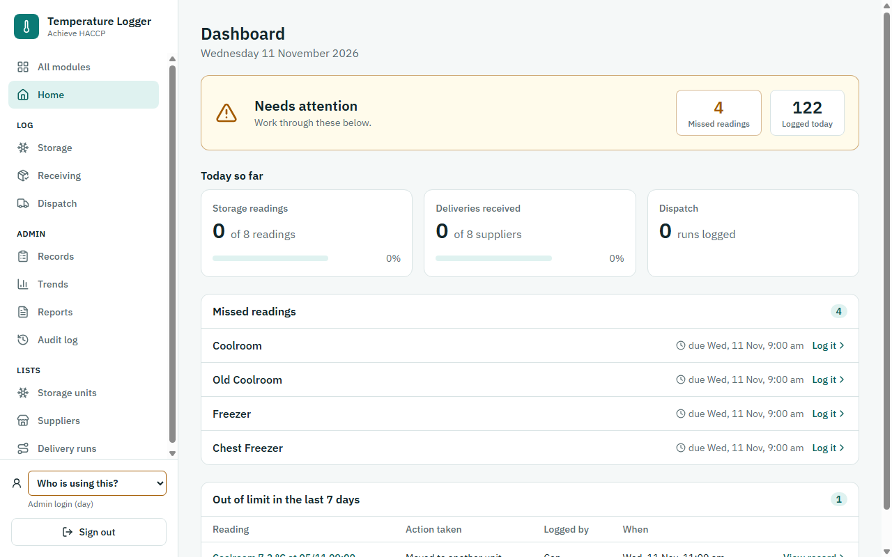

- **Needs attention** (top): how many readings are missed and how many were logged today. When everything is logged it says **All clear** in green.
- **Today so far:** how much storage, receiving and dispatch is done.
- **Missed readings:** each one has a **Log it** link.
- **Out of limit in the last 7 days:** the readings that were too warm, the action that was taken and who logged it.

### Records

**Records** shows every reading that has been saved. Use the buttons at the top for **Storage**, **Receiving** or **Dispatch**. Pick the month, or a single **Day**, filter to one unit, or tick **Out of limit only** or **Show voided**.

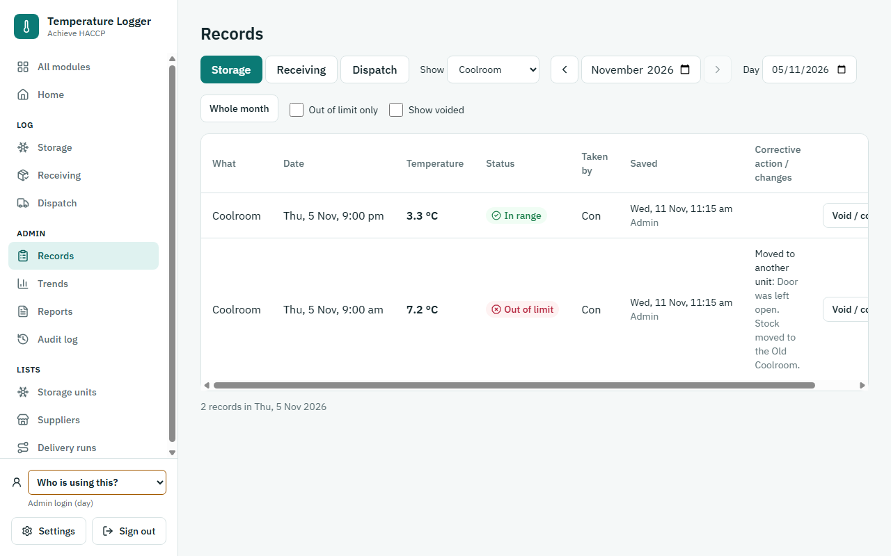

### Void and correct an entry

Mistakes are fixed by **voiding** the wrong entry and entering the right one. The wrong one stays in the records, marked void.

1. In **Records**, click **Void / correct** on the row.
2. Type **Why is it being changed?** (required). The reason is kept for the audit.
3. Type the **correct temperature**. Leave it empty to only void the entry.
4. Click **Void and save correction**.

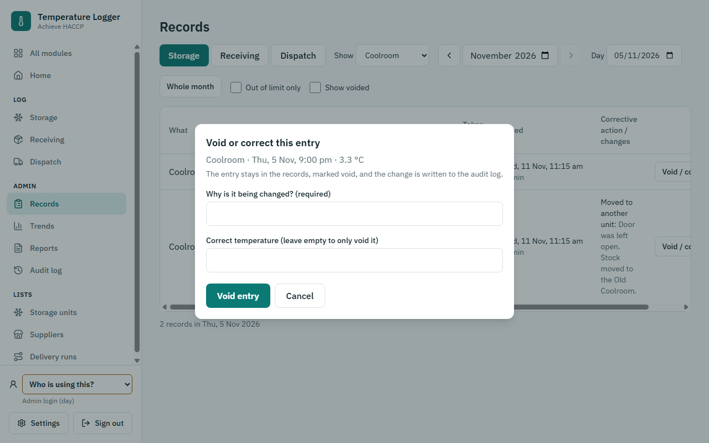

With **Show voided** ticked, the old entry is crossed out and the new one is marked **Corrected**.

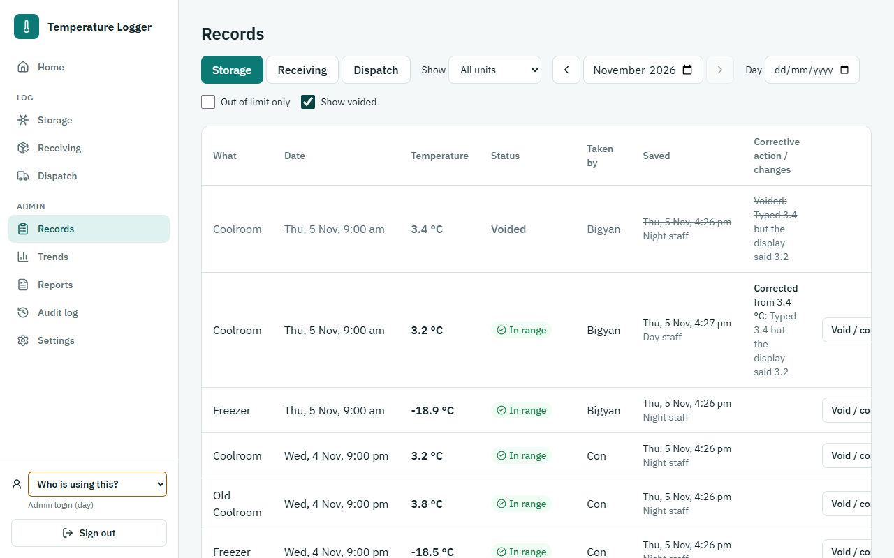

### Trends

**Trends** draws a line for each coolroom or freezer, with the limit as a dashed red line. Pick the unit and how many days to show. Use it to notice a unit that is slowly getting warmer before it goes out of limit.

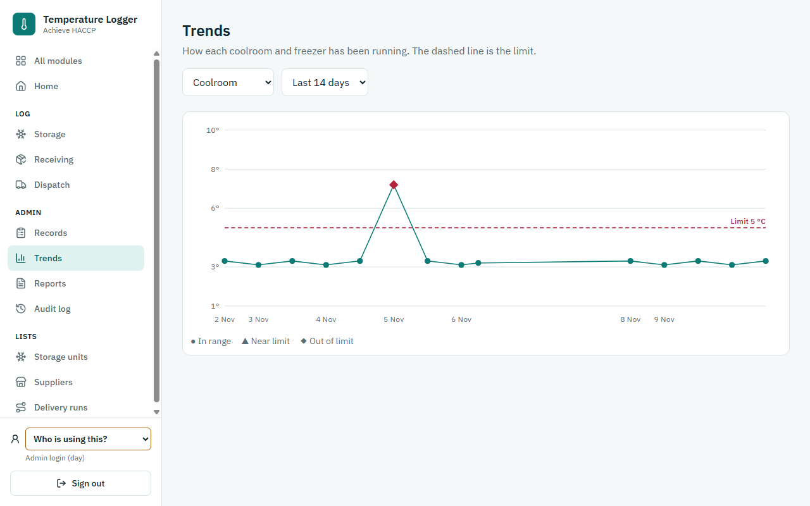

### Reports (PDFs for auditors)

**Reports** makes PDFs that look like the paper tables, with out-of-limit readings in red and the corrective actions listed underneath.

1. Choose **From** and **To** dates. The report always covers whole weeks (Sunday to Friday), so the dates are rounded out to full weeks.
2. Click **Open PDF** under **Table 9** (storage), **Table 10** (receiving) or **Table 11** (dispatch).

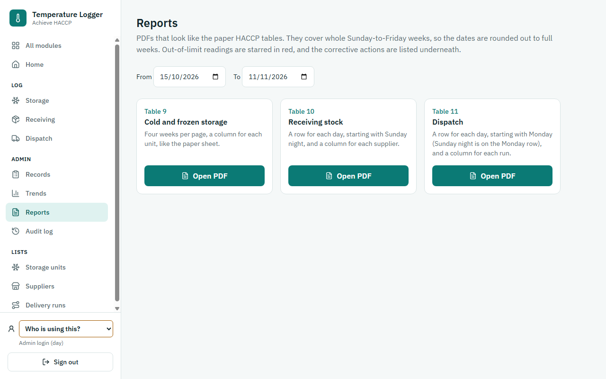

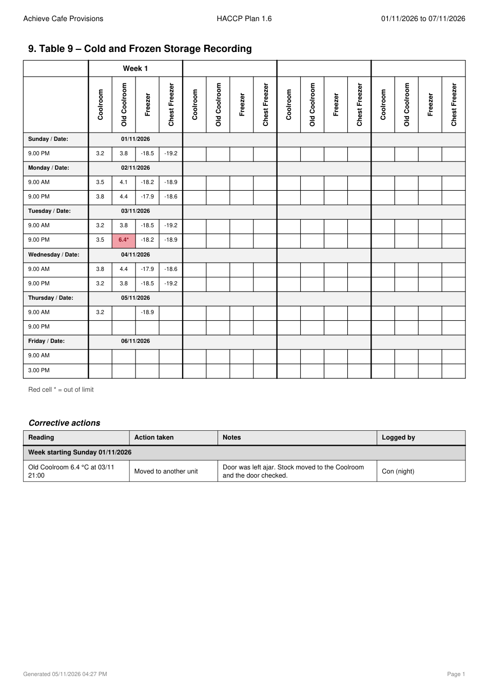

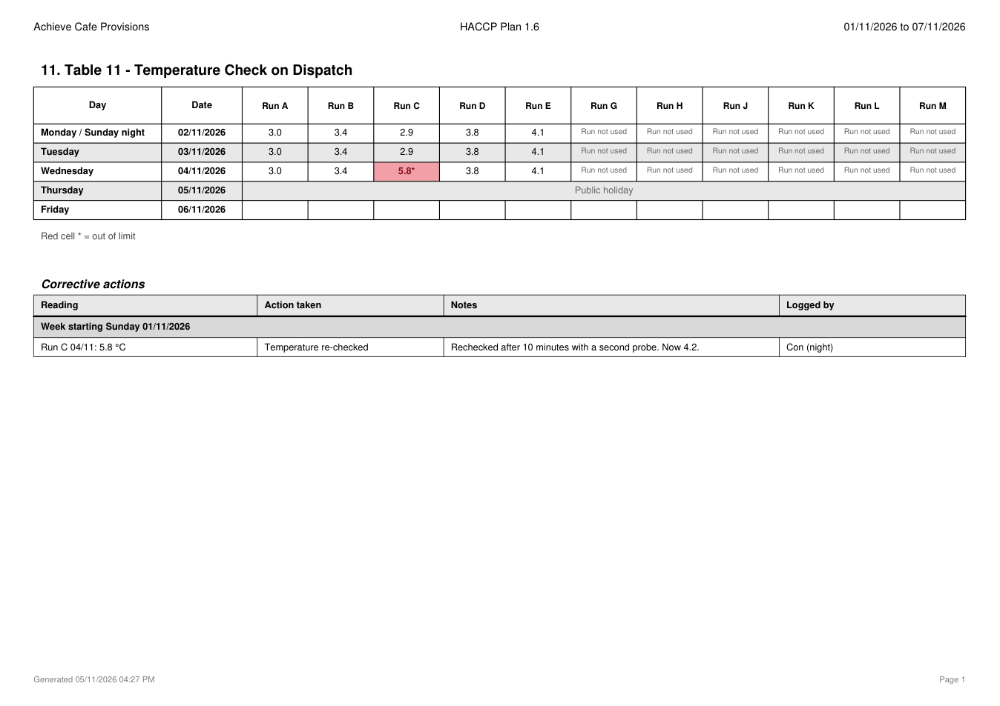

The reports are also **saved automatically** every 4 weeks, so you do not have to remember to make them (see the deployment notes for where they are saved).

### Audit log

The **Audit log** lists every void, correction, limit change, login change, public holiday change and deletion: who did it, when, and why. **It can never be edited or deleted.**

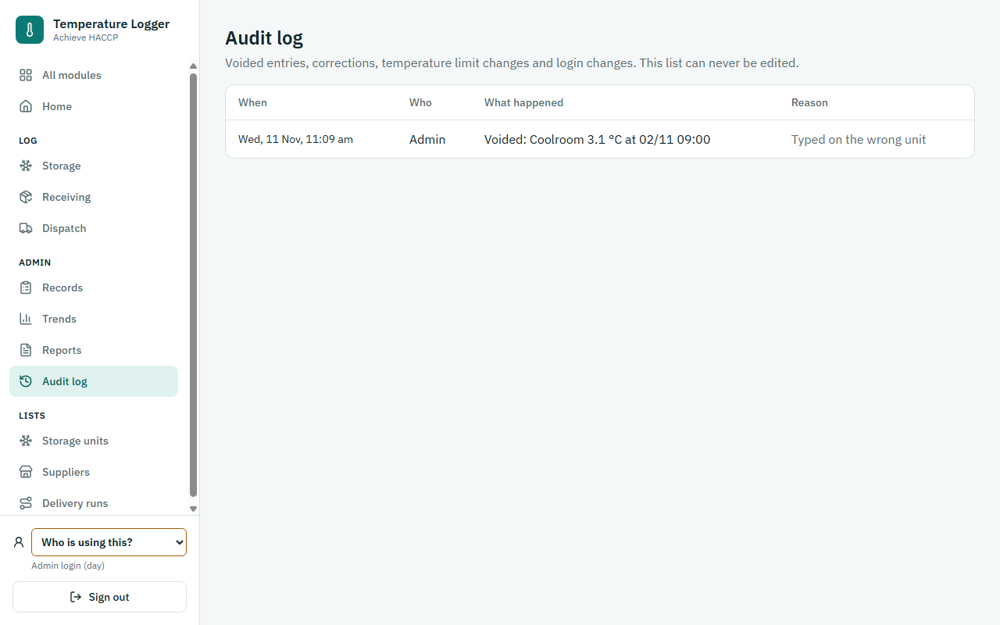

---

## 10. For day staff: Settings

Everything you manage is in **Settings** (the last item on the menu). The sections are along the top left.

### Staff names

The names staff pick from in **Your name**. Add every person who takes readings.

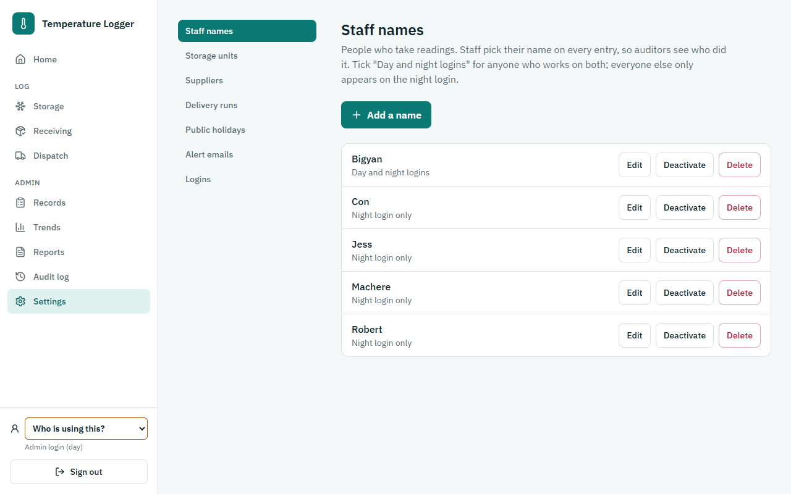

- Tick **Day and night logins** for people who work on both. Everyone else appears **only on the night login**.
- **Deactivate** when someone leaves. The name disappears from the picker, but their old entries keep their name.
- **Delete** is only possible for a name that was never used (for example, a typo). If it has records, the app refuses and tells you to deactivate it.

### Storage units

The coolrooms and freezers and their limits.

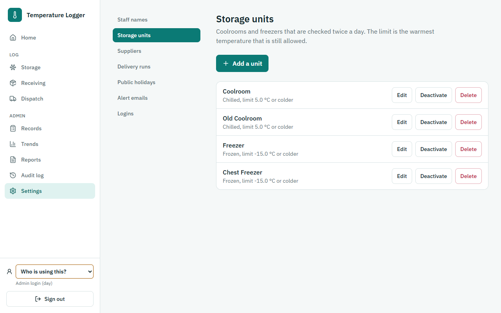

Changing a **limit** is written to the audit log, so only change it if the HACCP plan changes.

### Suppliers and delivery runs

Add a supplier or a run letter when you start using one, and **deactivate** it when you stop. Tick **Usually frozen** on a supplier so Receiving starts on Frozen for them.

### Public holidays

Add the dates that are public holidays.

1. Go to **Settings**, then **Public holidays**, then **Add a public holiday**.
2. Pick the **Date**. The **Name** is optional. Leave it blank for "Public holiday", or write something like "Public holiday - Christmas Day". The name appears on the reports.
3. Click **Save**.

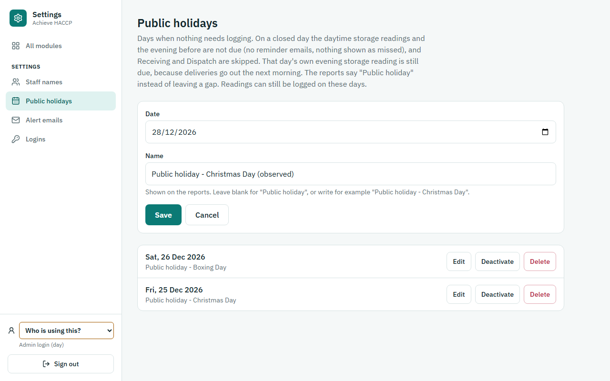

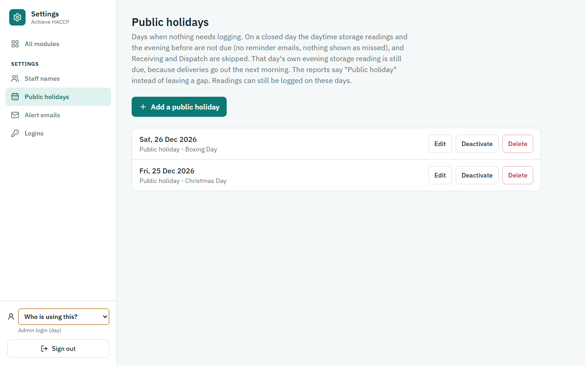

Add holidays **a few days ahead**, so the day-before 3 pm reading shows on the screens in time. If you add one by mistake, **Deactivate** or **Delete** it.

### Alert emails

The email addresses that receive the reminder emails (see the next section). Add an address to start getting them. **Deactivate** it to stop them.

### Logins

The shared logins (Admin and Night). You can change a password here, or add a login. Deactivate a login you no longer need.

---

## 11. Reminder emails

The people on the **Alert emails** list get an email when storage readings are late:

- **30 minutes before** a reading is due, if it is still not logged. (For example 8:30 am for the 9 am reading.)
- **3 hours after** it was due, if it is **still** not logged. This one is marked **STILL NOT LOGGED**.

The email lists the units that are still to do and links to the app. Nothing is sent if everything is already logged, or if it is a public holiday.

If the **nightly database backup** does not happen, the same people get a **DATABASE BACKUP FAILED** email, so a missing backup is noticed the next morning.

---

## 12. If something looks wrong

| What you see | What to do |
|---|---|
| **A white page, or "Loading…" that does not finish** | Wait a few seconds. If it says *Cannot reach the server yet*, the computer running the app may be restarting. Click **Sign in again** if it carries on. If it never comes back, tell day staff. |
| **"Your session ended. Please sign in again."** | You were signed out (the server restarted, or you were away a long time). Sign in again. Nothing you saved is lost. |
| **"Your name" is empty or wrong** | Pick your name from the list. Entries cannot be saved without it. |
| **"This unit already has a reading for that time"** | That reading was already logged. Look for **Logged by** on the row. If it is wrong, ask day staff to void and correct it. |
| **"Please check this value"** | The number looks unusual (for example a freezer above 0 °C). Fix a typo, or click **Yes, that is correct** if it is right. |
| **It will not save an out-of-limit reading** | Choose what was done from the **action** list. The note is optional. |
| **You entered a temperature on the wrong day** | Ask day staff to void it and enter it again (see [Void and correct](#void-and-correct-an-entry)). You cannot change it yourself. |
| **A banner says "A new version of the Temperature Logger is ready"** | Click **Refresh now** to get the latest version. |
| **You forgot to log a reading** | Log it as soon as you remember, on the correct **Day** and **time tab**, and add a **Note** that it was late. Do not guess a temperature: log what you actually read. |

---

## 13. Quick reference

**Limits**

| | Must be |
|---|---|
| Coolrooms, chilled deliveries, dispatch | **5 °C or colder** |
| Freezers, frozen deliveries | **-15 °C or colder** |
| Near limit warning | Within 1 °C of the limit |
| Freshly baked pies on receiving | Over 5 °C only if moved to the coolroom immediately |

**Storage times**

| Day | Times |
|---|---|
| Sunday | 9 pm |
| Monday to Thursday | 9 am, 9 pm |
| Friday | 9 am, 3 pm |
| Day before a public holiday (Mon to Thu) | 9 am, **3 pm** (no 9 pm) |

**Keyboard**

| Key | What it does |
|---|---|
| **Enter** | Storage: save the reading you just typed and move to the next unit. Receiving and Dispatch: move to the next row's temperature box; on the last row, save everything. Cleaning: tick the task and move to the next (in a Cleaning note, Enter starts a new line and Ctrl+Enter moves on). Forms (Calibration, Settings): move to the next box; after the last box Enter lands on Save, and a second Enter saves |
| **Tab** | Move to the next box |
| **A, B, C… (Dispatch)** | Tap that run |

**Remember**

- Always pick **your own name**.
- A reading that is too warm needs **an action** (a note is optional).
- **Nothing is deleted.** Day staff void and correct.
- Log a missed reading as soon as you can.
